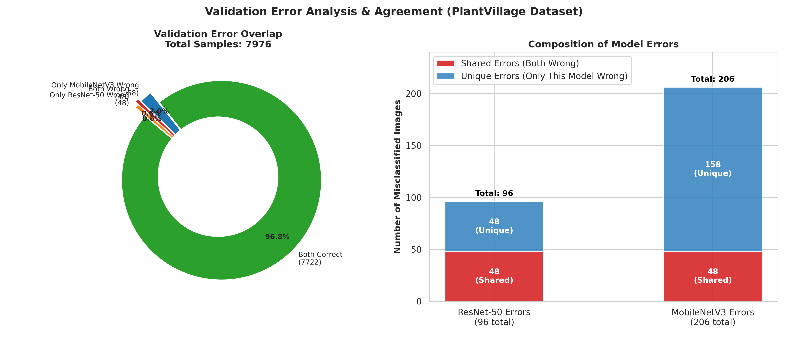
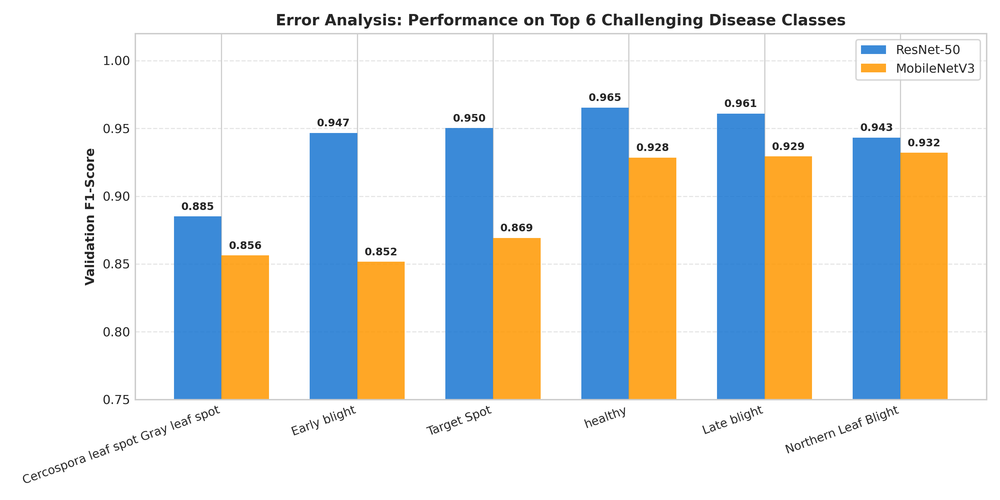
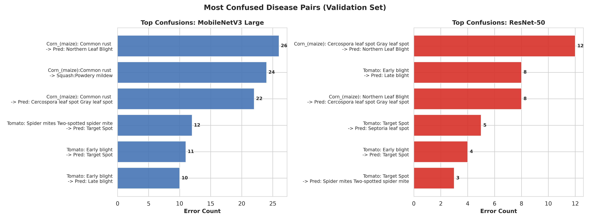
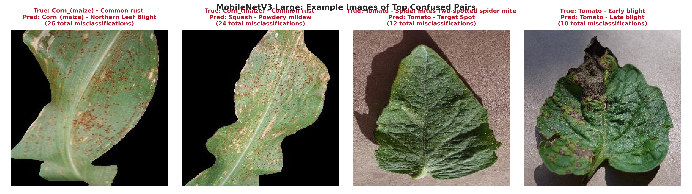
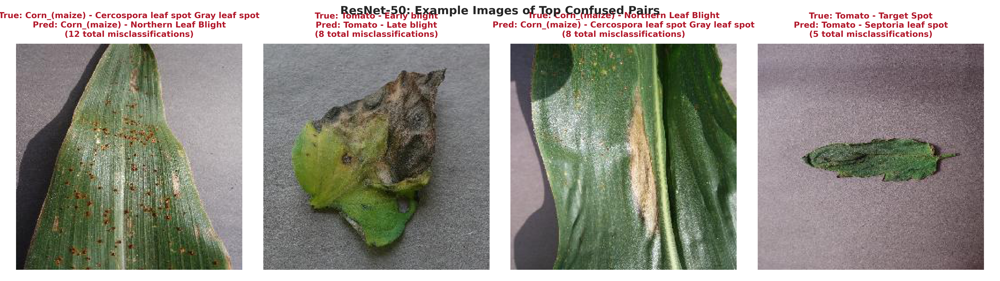
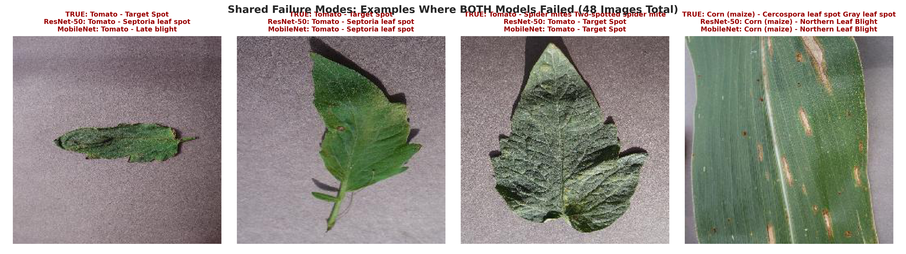
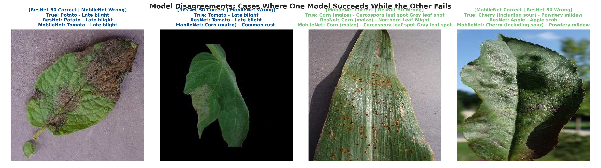

# Fine-Tuned Validation Error Analysis: ResNet-50 vs. MobileNetV3

---

## 1. Executive Summary & Comparative Overview

| Metric | ResNet-50 (Fine-Tuned) | MobileNetV3 Large (Fine-Tuned) | Difference / Winner |
| :--- | :--- | :--- | :--- |
| **Validation Accuracy** | **98.80%** (7,880 / 7,976) | **97.42%** (7,770 / 7,976) | ResNet-50 (+1.38%) |
| **Total Validation Errors** | **96 errors** (1.20%) | **206 errors** (2.58%) | ResNet-50 makes 110 fewer errors |
| **Architecture Type** | Residual ConvNet (23.6M params) | Depthwise Separable CNN (4.3M params) | MobileNet is ~5.5× lighter |
| **Recipe** | `uniform_p010` (100% fine-tuned) | `uniform_p010` (fine-tuned) | Identical augmentation |
| **Validation Split Size** | 7,976 images | 7,976 images | Exactly identical evaluation split |

---

## 2. Comparative Error Overlap Analysis (Venn Breakdown)

A critical question in model evaluation is whether errors are shared (systemic dataset ambiguities) or complementary (architectural differences).

| Category | Image Count | Percentage of Val Set | Description & Takeaway |
| :--- | :---: | :---: | :--- |
| **Both Correct** | **7,722** | **96.82%** | High consensus on clean, unambiguous leaf samples. |
| **Only MobileNetV3 Wrong** | **158** | **1.98%** | ResNet-50 correctly classifies these; MobileNet struggles with fine textures. |
| **Only ResNet-50 Wrong** | **48** | **0.60%** | MobileNetV3 correctly classifies these; complementary predictions. |
| **Both Wrong (Shared Failures)**| **48** | **0.60%** | Intrinsic ambiguities, heavy occlusion, or dual-infection leaf patterns. |
| **Total Validation Samples** | **7,976** | **100.00%** | Complete validation set. |

### Key Insight on Shared vs Unique Failures:
- Exactly **50.0%** of ResNet-50's total errors (48 out of 96) are also made by MobileNetV3. These 48 images represent the hard core of the dataset.
- ResNet-50 resolves **76.7%** (158 / 206) of MobileNetV3's errors.
- Conversely, MobileNetV3 correctly classifies **50.0%** (48 / 96) of ResNet-50's errors.
- **Ensemble Potential**: An ensemble of both models can theoretically achieve up to **99.40%** accuracy (7,928 / 7,976), missing only the 48 shared failures!

---

## 3. Weakest Classes Analysis

The weakest classes were ranked by validation F1-score and Recall.

### MobileNetV3 Large: Weakest Classes
| class                                              |   precision |   recall |   f1_score |   support |
|:---------------------------------------------------|------------:|---------:|-----------:|----------:|
| Corn_(maize)___Common_rust_                        |    0.990291 | 0.566667 |   0.720848 |       180 |
| Corn_(maize)___Cercospora_leaf_spot Gray_leaf_spot |    0.712766 | 0.87013  |   0.783626 |        77 |
| Corn_(maize)___Northern_Leaf_Blight                |    0.797753 | 0.965986 |   0.873846 |       147 |
| Tomato___Early_blight                              |    0.976378 | 0.826667 |   0.895307 |       150 |
| Tomato___Target_Spot                               |    0.878261 | 0.957346 |   0.9161   |       211 |

### ResNet-50: Weakest Classes
| class                                              |   precision |   recall |   f1_score |   support |
|:---------------------------------------------------|------------:|---------:|-----------:|----------:|
| Corn_(maize)___Cercospora_leaf_spot Gray_leaf_spot |    0.890411 | 0.844156 |   0.866667 |        77 |
| Tomato___Early_blight                              |    0.964286 | 0.9      |   0.931034 |       150 |
| Corn_(maize)___Northern_Leaf_Blight                |    0.92053  | 0.945578 |   0.932886 |       147 |
| Tomato___Target_Spot                               |    0.947368 | 0.938389 |   0.942857 |       211 |
| Potato___healthy                                   |    0.958333 | 0.958333 |   0.958333 |        24 |

### Key Observations:
1. **Common Vulnerabilities**:
   - Both models struggle significantly on **`Corn_(maize)___Cercospora_leaf_spot Gray_leaf_spot`** and **`Corn_(maize)___Northern_Leaf_Blight`**.
   - Both models exhibit lower sensitivity on **`Tomato___Early_blight`** and **`Tomato___Target_Spot`**.
2. **MobileNetV3 Specific Blindspot**:
   - MobileNetV3 suffers a severe degradation on **`Corn_(maize)___Common_rust_`** (misclassifying 72 instances as northern blight, powdery mildew, and gray leaf spot). ResNet-50 does not suffer from this issue.
3. **ResNet-50 Robustness**:
   - ResNet-50 maintains an F1-score above **0.90** on 37 out of 38 classes, with its sole sub-0.90 class being Corn Gray Leaf Spot (F1: 0.890).

---

## 4. Most Confused Disease Pairs

Analyzing off-diagonal misclassifications reveals domain-specific biological ambiguities.

### MobileNetV3: Top Confused Pairs
| True Class                                    | Predicted Class                                    |   count |
|:----------------------------------------------|:---------------------------------------------------|--------:|
| Corn_(maize)___Common_rust_                   | Corn_(maize)___Northern_Leaf_Blight                |      26 |
| Corn_(maize)___Common_rust_                   | Squash___Powdery_mildew                            |      24 |
| Corn_(maize)___Common_rust_                   | Corn_(maize)___Cercospora_leaf_spot Gray_leaf_spot |      22 |
| Tomato___Spider_mites Two-spotted_spider_mite | Tomato___Target_Spot                               |      12 |
| Tomato___Early_blight                         | Tomato___Target_Spot                               |      11 |

### ResNet-50: Top Confused Pairs
| True Class                                         | Predicted Class                                    |   count |
|:---------------------------------------------------|:---------------------------------------------------|--------:|
| Corn_(maize)___Cercospora_leaf_spot Gray_leaf_spot | Corn_(maize)___Northern_Leaf_Blight                |      12 |
| Tomato___Early_blight                              | Tomato___Late_blight                               |       8 |
| Corn_(maize)___Northern_Leaf_Blight                | Corn_(maize)___Cercospora_leaf_spot Gray_leaf_spot |       8 |
| Tomato___Target_Spot                               | Tomato___Septoria_leaf_spot                        |       5 |
| Tomato___Early_blight                              | Tomato___Target_Spot                               |       4 |

### Biological & Visual Failure Patterns:
1. **Gray Leaf Spot vs. Northern Leaf Blight (Corn)**:
   - Both diseases manifest as elongated, necrotic lesions running parallel to leaf veins. In intermediate stages, fungal lesion borders can appear visually identical on standard 224x224 / 256x256 resolution crops.
2. **Early Blight vs. Late Blight vs. Target Spot (Tomato)**:
   - Early Blight (*Alternaria solani*) causes concentric ring target patterns.
   - Target Spot (*Corynespora cassiicola*) causes brown lesions with concentric halos.
   - Under varying lighting and angle, the concentric rings are frequently confused by both architectures.
3. **MobileNetV3 Cross-Crop Mildew/Rust Confusion**:
   - MobileNetV3 misclassifies Corn Common Rust as Squash Powdery Mildew in 24 cases, indicating that depthwise separable kernels without sufficient receptive field or channel interactions can over-index on powdery white/yellow surface spores regardless of leaf morphology.

---

## 5. Visual Examples of Top Confusions & Errors

The following visual grids were directly extracted from the PlantVillage dataset images:

### A. MobileNetV3 Top Confusions

### B. ResNet-50 Top Confusions

### C. Shared Hard Failures (Both Models Wrong)

### D. Disagreements (One Model Correct, The Other Wrong)

---

## 6. Architectural Comparison & Diagnosis

| Dimension | ResNet-50 | MobileNetV3 Large |
| :--- | :--- | :--- |
| **Model Size** | 94.6 MB (23.6M params) | 17.2 MB (4.3M params) |
| **Kernel Representation** | Dense standard convolutions with residual shortcuts | Depthwise separable convolutions with inverted residual & SE blocks |
| **Texture Sensitivity** | High: Captures subtle concentric lesion rings and vein geometry | Moderate: Tends to blur micro-textures into generic spot signatures |
| **Deployment Recommendation**| Ideal for cloud backend / high-accuracy field diagnostic servers | Ideal for offline mobile apps, edge microcontrollers, and drones |

---

