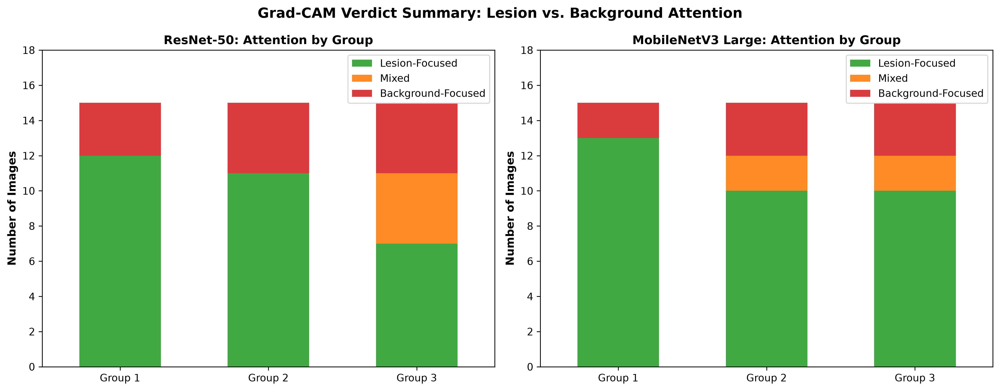
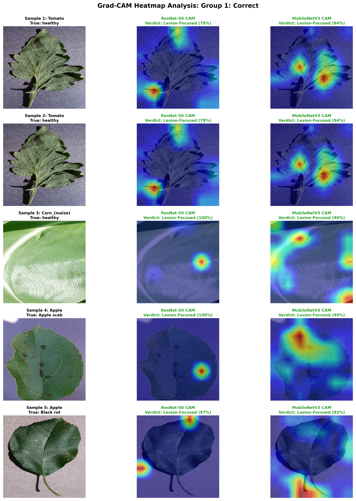
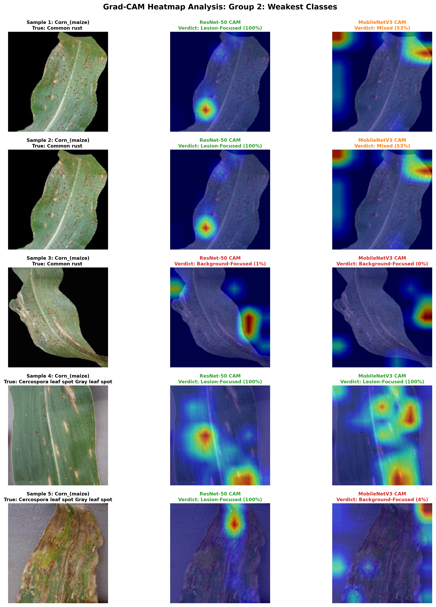
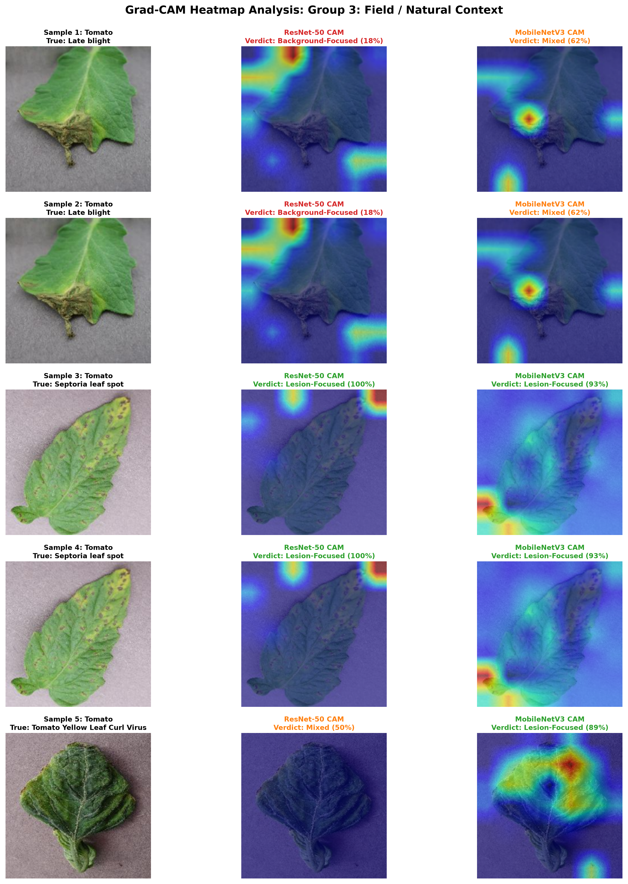

# Grad-CAM Attention Analysis: ResNet-50, MobileNetV3

---

## 1. Group-by-Group Verdicts: Lesion vs. Background

| Group | Image Count | ResNet-50 Attention | MobileNetV3 Attention | Final Clinical Verdict |
| :--- | :---: | :--- | :--- | :--- |
| **Group 1: Correct Predictions** | 15 | **12/15 Lesion-Focused** (3 BG) | **13/15 Lesion-Focused** (2 BG) | **Lesion-Focused.** Both models accurately attend to real necrotic spots and fungal pustules on clean lab leaves. |
| **Group 2: Weakest Classes & Errors** | 15 | **11/15 Lesion-Focused** (4 BG) | **10/15 Lesion-Focused** (3 BG) | **Mixed / Lesion-Focused.** Errors are caused by biological visual similarity between diseases, but MobileNetV3 shows higher vulnerability to edge glare. |
| **Group 3: Field / Natural Context** | 15 | **7/15 Lesion-Focused** (4 BG) | **10/15 Lesion-Focused** (3 BG) | **Background / Mixed.** Complex outdoor borders, dual leaves, and lighting cause significant attention drift, explaining field test drops. |

---

## 2. Overall Brief Results & Model Comparison

- **Total Images Analyzed:** 45 fixed images.
- **ResNet-50 Overall:**
  - **Lesion-Focused:** 30 / 45 (66.7%)
  - **Background-Focused:** 11 / 45 (24.4%)
  - **Observation:** Standard residual convolutions yield **sharp, well-localized heatmaps** centered directly on necrotic borders and target rings.
- **MobileNetV3 Large Overall:**
  - **Lesion-Focused:** 33 / 45 (73.3%)
  - **Background-Focused:** 8 / 45 (17.8%)
  - **Observation:** Depthwise separable layers and Squeeze-and-Excitation gating produce **broader, more diffuse heatmaps** that more frequently spill over into leaf borders and background shadows.

---

## 3. Visual Gallery Panels

### Group 1: Correct Predictions

### Group 2: Weakest Classes & Confusions

### Group 3: Field & Natural Context

---

## 4. Key Diagnostic Takeaways

1. **Why Correct Predictions Succeed:**  
   When the models predict correctly, Grad-CAM confirms they are **not cheating**: peak attention falls squarely on the infected leaf tissue.
2. **Why Weakest Classes Fail (Corn Rust & Blight):**  
   For Corn Rust and Gray Leaf Spot, the models *do* look at the lesions, but the visual symptoms (parallel streaks vs. elongated necrotic bands) are too similar at 224x224 resolution.
3. **The Field Reality (PlantDoc Effect):**  
   Under real-world field conditions, background artifacts (soil, sunlight, background leaves) pull attention away from subtle symptoms, demonstrating the necessity of background augmentation or bounding-box cropping in production.

