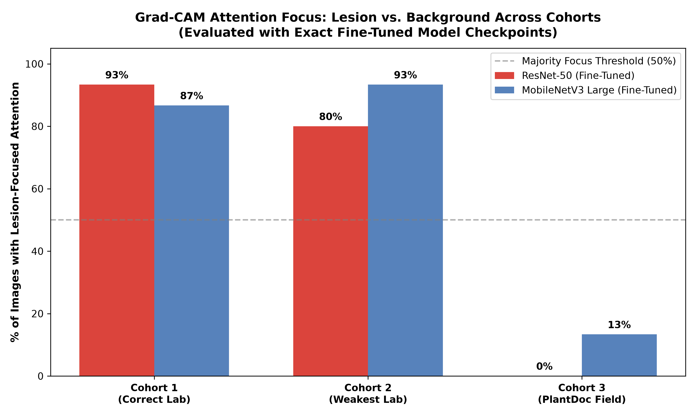

# TerraVista · Crop disease detection

**IIIT Hyderabad Minor Degree Program · Project 8**

Upload a leaf photo to compare two convolutional networks across 38 crop and condition classes. TerraVista shows the predicted class, calibrated confidence and a Grad-CAM overlay. The project also asks a harder question: how much of the accuracy measured on lab leaves carries over to field photos?

**[Open the live app](https://image-based-crop-disease-detection-cnn.streamlit.app/)** · [Project tour](#project-tour) · [Results](#what-the-models-learned) · [Run locally](#run-locally) · [Extension service brief](docs/deployment_brief.md)

## Inside the app

| Page | What to try |
|---|---|
| **Leaf analysis** | Upload a close-up of one leaf. Start with MobileNetV3-Large or switch to ResNet-50 to compare their scores and heatmaps. |
| **Results** | Explore the held-out PlantVillage results and the matched lab–field comparison. This page reads the evaluation tables directly and works without downloading weights. |

At **80% calibrated confidence or above**, the app shows the class and its care guidance. Below 80%, it returns **Unsure**. Expand the result to inspect the tentative class and heatmap. Orange marks regions that supported the model’s top score, which can include background. The classifier can also assign high scores to unfamiliar objects. [Care guide for all 38 classes](data/class_care.json)

## What the models learned

**ResNet-50 reached 0.9821 macro-F1 on the full PlantVillage test.** On the matched 27-class comparison, its score fell from **0.9806 in the lab to 0.2822 in the field**. MobileNetV3-Large showed the same pattern. Macro-F1 gives each class equal weight, so frequent crops cannot dominate the average.

| Test cohort | Images | Classes | ResNet-50 | MobileNetV3-Large |
|---|---:|---:|---:|---:|
| PlantVillage · full held-out test | 7,978 | 38 | 0.9821 | 0.9644 |
| PlantVillage · matched, duplicate-screened | 5,169 | 27 | 0.9806 | 0.9605 |
| PlantDoc · matched, duplicate-screened | 241 | 27 | 0.2822 | 0.2320 |

Scores are mean macro-F1 across seeds **42, 123 and 2026**. The app uses the seed-42 checkpoint for each architecture. The last two rows compare the same set of crop conditions. [Lab evaluation and confidence intervals](experiments/test_evaluation/README_handover.md) · [Field evaluation and overlap audit](experiments/plantdoc-field-test/README.md)

## Project tour

| Stage | What the team completed | Explore |
|---|---|---|
| **Dataset preparation** | Reviewed duplicates, recorded removal decisions and fixed the PlantVillage split at 37,751 training, 7,976 validation and 7,978 test images. All 38 classes appear in each split. | [Duplicate review](data/duplicates) · [Split manifest and class counts](data/split/README.md) |
| **Augmentation and baselines** | Tested augmentation policies and probabilities, then compared five recipes across three seeds. With a frozen ResNet-50, the unaugmented baseline led at 0.9500 validation macro-F1. | [Augmentation study](experiments/augmentation-study/README.md) · [Frozen baseline](experiments/frozen_resnet50/README.md) |
| **Class imbalance** | Compared focal loss against cross-entropy on frozen classifiers. On MobileNetV3-Large, focal loss gave no clear improvement for the five smallest classes. | [Loss experiments](experiments/focal_loss) · [MobileNetV3 comparison](experiments/focal_loss/mobilenetv3/comparison_table.csv) |
| **Final CNNs** | Measured ResNet-50 data efficiency using six training fractions from 1% to 100%. The final models used full fine-tuning and the uniform augmentation recipe `uniform_p010`. | [ResNet-50 runs](models/resnet50) · [MobileNetV3 training and evaluation](models/mobilenetv3_large) |
| **Independent evaluation** | Evaluated six final checkpoints on held-out PlantVillage images, checked for near-duplicates and mapped PlantDoc labels for a field test. | [Lab predictions and metrics](experiments/test_evaluation) · [PlantDoc mapping](data/plantdoc/README.md) |
| **Calibration** | Fit a temperature per checkpoint on half the validation set and evaluated it on the other half. The lab calibration study supplied the app’s 80% abstention rule. | [Method and reliability diagrams](docs/calibration/README.md) · [Calibration outputs](results/calibration) |
| **Error analysis and Grad-CAM** | Compared the models’ recurring confusions and shared mistakes across seeds. Inspected heatmaps for correct predictions, weak classes and field examples. | [Error tables](analysis/error_analysis) · [Grad-CAM examples](analysis/gradcam_analysis) |
| **Deployment** | Connected the same CPU inference code to a command-line predictor and a two-page Streamlit app. Only the selected model is cached in memory. | [Predictor](app/predict.py) · [Streamlit app](app/streamlit_app.py) |

<details>
<summary><strong>See the team’s Grad-CAM comparison</strong></summary>



[Inspect the image-level predictions and heatmap measurements](analysis/gradcam_analysis/gradcam_evaluation_results.csv)

</details>

## Run locally

Use **Python 3.12**. Clone the branch that contains the app.

```bash
git clone --branch streamlit-leaf-app https://github.com/dev-astitva/image-based-crop-disease-detection-cnn.git
cd image-based-crop-disease-detection-cnn
python -m venv .venv
```

Activate with `source .venv/bin/activate` on macOS or Linux, or `.\.venv\Scripts\Activate.ps1` in Windows PowerShell. Then run:

```bash
python -m pip install -r requirements.txt
python -m streamlit run app/streamlit_app.py
```

### Get the trained weights

The app downloads the selected seed-42 checkpoint from version 1 of the team’s private Kaggle dataset, verifies its SHA-256 checksum and reuses the local copy. Set `KAGGLE_API_TOKEN` in your environment using an account with dataset access. Legacy `KAGGLE_USERNAME` and `KAGGLE_KEY` are also supported. [TerraVista checkpoints on Kaggle](https://www.kaggle.com/datasets/3c624b2b02c92dff7c68454d82fe0d51e0685fb12dc2fafeece8f1257eb13bfd)

<details>
<summary><strong>Offline setup or a direct download mirror</strong></summary>

Extract the Kaggle ZIP and copy the files below into `~/.cache/terravista/` (Windows: `%USERPROFILE%\.cache\terravista\`). To use a different cache directory, set `LEAF_MODEL_CACHE`.

| File ending in the dataset | Filename in the local cache |
|---|---|
| `mobilenetv3_large_uniform_p010_seed42/best_weights.pt` | `mobilenetv3_large_seed42.pt` |
| `frac100_seed42/best_model.pt` | `resnet50_seed42.pt` |

For a mirror containing the same checkpoint bytes, set `MOBILENETV3_LARGE_URL` or `RESNET50_URL` to the respective direct download URL.

</details>

### Run a prediction from the terminal

```bash
python app/predict.py leaf.jpg --model mobilenetv3_large --heatmap overlay.png
```

Use `--model resnet50` to switch architectures. Both entry points convert the photo to RGB, resize it to 224 × 224 with bilinear interpolation, apply ImageNet normalization and compute `softmax(logits / temperature)`. The command prints the top class, decision, confidence, temperature and threshold as JSON and writes the requested overlay.

### Deploy on Streamlit Community Cloud

Choose repository `dev-astitva/image-based-crop-disease-detection-cnn`, branch `streamlit-leaf-app`, entry point `app/streamlit_app.py` and Python 3.12. Put the Kaggle token in **Advanced settings → Secrets** as a top-level `KAGGLE_API_TOKEN` entry. After deployment, upload a leaf with each model to verify checkpoint access. Before a demo, wake the app ten minutes early and keep a local cached copy and a screen recording available. [Streamlit Community Cloud](https://share.streamlit.io/)
