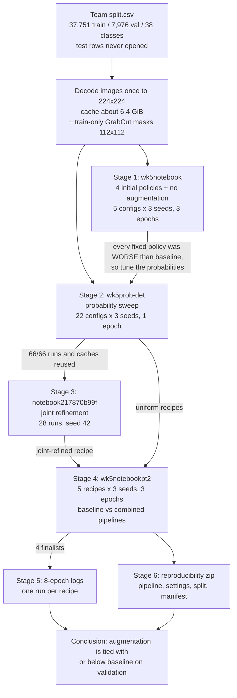
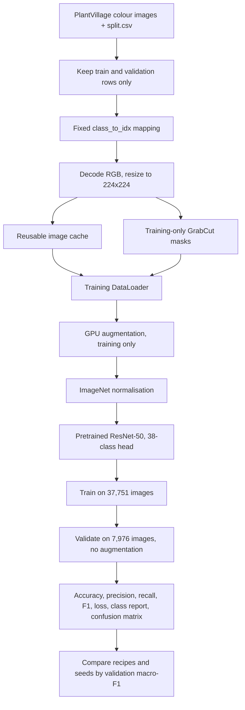

# Augmentation Study on PlantVillage (ResNet-50)

*A guided tour of how the zip package, the four notebooks and the 8-epoch logs connect, what each one found, and what it means.*

---

## Contents
1. [Overview and main result](#1-overview-and-main-result)
2. [Index](#2-index)
3. [Dataset, evaluation setup and metric glossary](#3-dataset-evaluation-setup-and-metric-glossary)
4. [How the files connect and how one image flows](#4-how-the-files-connect-and-how-one-image-flows)
5. [Shared model and training protocol](#5-shared-model-and-training-protocol)
6. [Stage 1 – Four initial policies](#6-stage-1--four-initial-policies-wk5notebookipynb)
7. [Stage 2 – Probability tuning](#7-stage-2--probability-tuning-wk5prob-detipynb)
8. [Stage 3 – Joint refinement](#8-stage-3--joint-refinement-notebook217870b99fipynb)
9. [Stage 4 – Five-recipe comparison](#9-stage-4--five-recipe-comparison-wk5notebookpt2ipynb)
10. [Stage 5 – Eight-epoch logs](#10-stage-5--eight-epoch-logs)
11. [Stage 6 – Reproducibility package](#11-stage-6--reproducibility-package-zip)
12. [Conclusions](#12-conclusions)
13. [Recommended next experiment](#13-recommended-next-experiment)
14. [Reporting checklist](#14-reporting-checklist)
15. [File inventory and notes](#15-file-inventory-and-notes)

---

## 1. Overview and main result

TerraVista classifies PlantVillage leaf photos into **38 disease / healthy categories** using a pretrained **ResNet-50**. This study asks one question: **does image augmentation improve validation performance, and if so, which augmentations at which probabilities?**

The work was done in stages. All stages share the same data split and the same ResNet-50 setup, but they do **not** share the same training budget (1, 3 or 8 epochs), so **always read a number together with its epoch count and seed count.**

| Stage | File | Runs | Epochs | Seeds |
|---|---|---|---|---|
| 1 | `wk5notebook.ipynb` | 5 configs × 3 seeds = 15 | 3 | 42, 123, 2026 |
| 2 | `wk5prob-det.ipynb` | 22 configs × 3 seeds = 66 | 1 | 42, 123, 2026 |
| 3 | `notebook217870b99f.ipynb` | the same 66 (reused) + 28 new | 1 | 66: three seeds; 28: seed 42 only |
| 4 | `wk5notebookpt2.ipynb` | 5 recipes × 3 seeds = 15 | 3 | 42, 123, 2026 |
| 5 | 8-epoch logs zip | 4 recipes × 1 run | 8 | one run each (seed not saved in the files; see Stage 5) |
| 6 | reproducibility zip | code to repeat Stage 4 | 3 | 42, 123, 2026 |

### Main result in four lines

| Finding | Evidence |
|---|---|
| **Baseline wins the matched 3-seed comparison** | Macro-F1 **0.98467 ± 0.00085** (no augmentation) vs **0.98410 ± 0.00224** (best augmented recipe, Uniform 0.10) |
| **Fixed "augment everything" policies hurt** | −0.0045 to −0.0055 macro-F1, bigger than the seed spread (Stage 1) |
| **No single family helps on its own** | The best single-family probability (cutout 0.25) gained only +0.00002 ± 0.00022 (Stage 2) |
| **Longer training lifts everyone to ≈ 0.990–0.991 macro-F1** | The four recipes differ by at most 0.0007 macro-F1 in one run each, which is too small to name a winner (Stage 5) |

> **Evaluation boundary.** Every file here uses **training and validation images only**. No test image was opened and no test score exists. Do not describe any number below as test accuracy or as real-world performance.

---

## 2. Index

| requirement | solved by | section |
|---|---|---|
| **Tune probabilities** for flips, rotation, colour jitter, blur, sensor noise, cutout and background replacement | `wk5prob-det.ipynb`: 66 runs; best p per family in the table | 7 |
| **Test the selected probabilities together**, then **compare the final pipeline against the baseline** | `notebook217870b99f.ipynb` (joint refinement, 28 runs), `wk5notebookpt2.ipynb` (5 recipes × 3 seeds), 8-epoch logs | 8, 9, 10 |
| **Before/after grids** | `augmentation_probability_visual_check.png` (4 training images × original + 7 families), created by `wk5prob-det` and `notebook217870b99f`; GrabCut mask previews in every notebook | 7 |
| **Validation macro-F1 mean ± standard deviation across three seeds** | Mean ± SD tables in Sections 6, 7, 9 | 6, 7, 9 |
| Supporting metrics | Accuracy, macro-precision, macro-recall, weighted-F1, validation loss, per-class report, confusion matrices | 6–10 |

---

## 3. Dataset, evaluation setup and metric glossary

| Item | Value |
|---|---|
| Dataset | PlantVillage colour images |
| Classes | 38 |
| Training images | 37,751 |
| Validation images | 7,976 |
| Images used for model selection | 45,727 |
| Test rows in the original split | 7,978 (**never opened**) |
| Test rows in the handoff `train_val_split.csv` | 0 |
| Input | RGB, 224 × 224 |
| Main selection metric | Validation macro-F1 |
| Seeds | 42, 123, 2026 |

The bundled `class_to_idx.json` fixes the alphabetical class order. Rebuilding the mapping separately can silently change what a label number means, so always use the supplied file.

### Metric glossary (simple words)

| Term | Meaning here |
|---|---|
| **Accuracy** | Correct predictions ÷ all validation images |
| **Precision** | Of the images the model called class X, how many really are X |
| **Recall** | Of the images that really are X, how many the model found |
| **F1** | One number that balances precision and recall (harmonic mean) |
| **Macro-F1 / precision / recall** | Compute per class, then a plain average over the 38 classes, so small classes count as much as big ones. |
| **Weighted-F1** | Same, but big classes count more (behaves like accuracy) |
| **Validation loss** | Cross-entropy on unaugmented validation images; lower is better |
| **Confusion matrix** | Table of true class vs predicted class; the diagonal is the correct ones |
| **Support** | Number of validation images in a class |
| **Seed** | Number that fixes the random choices; a different seed gives a slightly different run |
| **Mean ± SD** | Average over 3 seeds ± the **sample** standard deviation (how much luck alone moves the score) |
| **Paired Δ vs baseline** | For each seed: recipe minus baseline; then the mean and SD of those 3 differences |
| **"Beyond seed spread"** | The rule used throughout: a difference counts only if its size is **larger than its own SD**; otherwise it is a tie |
| **Epoch / best epoch** | One pass over the training images / the epoch with the highest validation macro-F1 (the score reported for a run) |

For one-label-per-image problems, weighted recall equals accuracy, so it is not shown separately.

**Why macro-F1 first?** Class sizes differ (for example 823 Orange images vs 24 Potato healthy). Accuracy can look excellent while a small class does badly; macro-F1 does not hide that.

---

## 4. How the files connect and how one image flows

### 4a. How the study stages connect

### 4b. The training pipeline shared by every notebook

### 4c. What happens to one image

1. Path and label come from the fixed split file.
2. The image is decoded as RGB, resized to 224 × 224 and stored in a cache so no recipe re-decodes the original file.
3. **Training only:** each augmentation family is switched on for that image with its own probability, independently of the others.
4. If background replacement is on, a cached foreground mask keeps the leaf and replaces only the estimated background.
5. The batch becomes float, channels-first, ImageNet-normalised, and goes into ResNet-50.
6. **Validation:** all randomness is off. Only resize and normalisation are applied.
7. Predictions are compared with the true labels to produce every metric and report.

### 4d. The seven augmentation families

| Family | What it does | Fixed strength |
|---|---|---|
| Flips | Mirrors the leaf (horizontal / vertical) | Axis chosen at random |
| Rotation | Turns the leaf | Up to ±15° |
| Colour jitter | Lighting and colour change | Brightness 0.60–1.40 (includes darkening), contrast 0.80–1.20, saturation 0.80–1.20, hue ±0.02 |
| Gaussian blur | Softens detail | 5 × 5 kernel |
| Sensor noise | Small pixel noise | SD 0.02 (on 0–1 colour values) |
| Cutout | Hides a rectangle | 2 %–15 % of the image |
| Background replacement | Swaps estimated background for a muted solid, gradient or soft texture | GrabCut alpha mask at 112 × 112 (255 keeps plant, 0 replaces background) |

The probability `p_*` says **how often** a family is used, not **how strong** it is. `p_colour = 0.20` means about 20 % of training images get colour changes, each within the ranges above.

**Background-mask caution.** GrabCut is a heuristic, not true segmentation. A failed or implausible mask falls back to "keep the original image". The notebooks report 37,751 training masks and **0** fallbacks in the controlled run. Validation images never get random backgrounds.

---

## 5. Shared model and training protocol

Identical in every notebook, so only augmentation changes.

| Setting | Value |
|---|---|
| Architecture | TorchVision ResNet-50, `ResNet50_Weights.DEFAULT` (ImageNet) |
| Head | `fc` replaced with 2,048 → 38 |
| Fine-tuning | All layers trainable |
| Optimizer | AdamW, two groups: backbone LR `1e-5`, classifier LR `5e-4`, weight decay `1e-4` |
| Loss / scheduler | CrossEntropy / none |
| Batch size | 32 train, 64 validation |
| Precision | FP16 mixed precision with gradient scaling |
| Normalisation | ImageNet mean (0.485, 0.456, 0.406), std (0.229, 0.224, 0.225) |
| Determinism | cuDNN deterministic on, benchmark off, seeds fixed |
| Environment | Kaggle, PyTorch 2.11.0+cu128, TorchVision 0.26.0+cu128, device `cuda` |

The logs show a "T4 ×2" accelerator was selected, but they do not prove both GPUs were used, so this README does not call the training multi-GPU.

---

## 6. Stage 1 — Four initial policies + no augmentation test (`wk5notebook.ipynb`)

**Purpose:** add one augmentation at a time, and see if each helps. **Design:** 5 configs × 3 seeds × 3 epochs = 15 runs. Policies are applied to every image: flips p = 0.5 each, rotation ±15°, colour 0.9–1.1, cutout p = 0.25 (max 10 %), background p = 0.10 (an extra project feature). Blur and noise were kept out on purpose so only one factor changes per step.

| Run | What is applied |
|---|---|
| `00_no_augmentation` | Resize + normalise only |
| `01_flips_rotation` | + flips and rotation |
| `02_flips_rotation_colour` | + colour |
| `03_flips_rotation_colour_cutout` | + cutout |
| `04_previous_plus_background_variation` | + background replacement |

| Config | Val accuracy (mean ± SD) | **Val macro-F1 (mean ± SD)** | Δ macro-F1 vs baseline (mean ± SD) | Verdict |
|---|---|---|---|---|
| Baseline (no augmentation) | 0.98834 ± 0.00076 | **0.98467 ± 0.00085** | — | — |
| + Flips + rotation | 0.98408 ± 0.00160 | **0.97915 ± 0.00190** | -0.00552 ± 0.00205 | Worse, beyond seed spread |
| + Colour | 0.98470 ± 0.00142 | **0.98013 ± 0.00122** | -0.00453 ± 0.00135 | Worse, beyond seed spread |
| + Cutout | 0.98504 ± 0.00151 | **0.97973 ± 0.00214** | -0.00493 ± 0.00285 | Worse, beyond seed spread |
| + Background variation (extra) | 0.98537 ± 0.00040 | **0.97995 ± 0.00213** | -0.00471 ± 0.00226 | Worse, beyond seed spread |

**Per-seed macro-F1 (best epoch):**

| Config | Seed 42 | Seed 123 | Seed 2026 | Mean | SD |
|---|---|---|---|---|---|
| Baseline (no augmentation) | 0.9853 | 0.9850 | 0.9837 | 0.98467 | 0.00085 |
| + Flips + rotation | 0.9775 | 0.9812 | 0.9788 | 0.97917 | 0.00188 |
| + Colour | 0.9814 | 0.9790 | 0.9801 | 0.98017 | 0.00120 |
| + Cutout | 0.9798 | 0.9776 | 0.9819 | 0.97977 | 0.00215 |
| + Background variation (extra) | 0.9820 | 0.9777 | 0.9802 | 0.97997 | 0.00216 |

**Reading it:** every augmented step is **0.0045–0.0055 below baseline, beyond its seed spread**. Between consecutive augmented steps the differences are inside the spread (inconclusive). Selected configuration: **00 No augmentation**.

**Budget caution:** 13 of 15 runs peaked at the last (3rd) epoch, so this is a short-budget screen, not proof of convergence.

---

## 7. Stage 2 — Probability tuning (`wk5prob-det.ipynb`)

**Purpose:** instead of "on or off", find *how often* each family should be applied. **Design:** baseline + 7 families × 3 probabilities (0.10, 0.25, 0.50), one family at a time with everything else off = **22 configs × 3 seeds = 66 runs, 1 epoch each**.

**Macro-F1 (mean ± SD over 3 seeds) for every tested setting, with paired Δ vs baseline:**

| Family | p = 0.10 | p = 0.25 | p = 0.50 | Observed best p | Recommended p (after seed-spread rule) |
|---|---|---|---|---|---|
| *Baseline (all p = 0)* | 0.9733 ± 0.0031 | | | | |
| Flips | 0.9719 ± 0.0024 (Δ -0.0015) | 0.9706 ± 0.0015 (Δ -0.0027) | 0.9697 ± 0.0027 (Δ -0.0036) | 0.10 | 0.00 |
| Rotation ±15° | 0.9725 ± 0.0024 (Δ -0.0008) | 0.9725 ± 0.0016 (Δ -0.0008) | 0.9713 ± 0.0039 (Δ -0.0021) | 0.25 | 0.00 |
| Colour jitter (incl. darkening) | 0.9728 ± 0.0035 (Δ -0.0006) | 0.9721 ± 0.0030 (Δ -0.0012) | 0.9718 ± 0.0025 (Δ -0.0016) | 0.10 | 0.00 |
| Gaussian blur | 0.9726 ± 0.0033 (Δ -0.0007) | 0.9727 ± 0.0022 (Δ -0.0006) | 0.9709 ± 0.0025 (Δ -0.0024) | 0.25 | 0.00 |
| Sensor noise | 0.9728 ± 0.0041 (Δ -0.0005) | 0.9728 ± 0.0037 (Δ -0.0005) | 0.9720 ± 0.0041 (Δ -0.0013) | 0.25 | 0.00 |
| Cutout | 0.9730 ± 0.0034 (Δ -0.0004) | 0.9734 ± 0.0033 (Δ +0.0000) | 0.9722 ± 0.0039 (Δ -0.0012) | 0.25 | 0.00 |
| Background replacement | 0.9718 ± 0.0029 (Δ -0.0015) | 0.9702 ± 0.0024 (Δ -0.0031) | 0.9639 ± 0.0061 (Δ -0.0095) | 0.10 | 0.00 |

*Computed from the per-run scores printed in the notebook log; the 5th decimal may differ from the CSV.*

**Best tested probability per family (values printed by the notebook):**

| Family | Best tested p | Mean macro-F1 at that p ± SD | Paired Δ vs baseline ± SD | Recommended p |
|---|---|---|---|---|
| Flips | 0.10 | 0.97187 ± 0.00242 | −0.00147 ± 0.00123 | 0.00 |
| Rotation | 0.25 | 0.97253 ± 0.00163 | −0.00081 ± 0.00145 | 0.00 |
| Colour jitter | 0.10 | 0.97276 ± 0.00350 | −0.00058 ± 0.00111 | 0.00 |
| Gaussian blur | 0.25 | 0.97271 ± 0.00215 | −0.00063 ± 0.00106 | 0.00 |
| Sensor noise | 0.25 | 0.97284 ± 0.00373 | −0.00049 ± 0.00119 | 0.00 |
| Cutout | 0.25 | 0.97336 ± 0.00324 | +0.00002 ± 0.00022 | 0.00 |
| Background replacement | 0.10 | 0.97182 ± 0.00288 | −0.00152 ± 0.00064 | 0.00 |
| *Baseline (all p = 0)* | — | *0.97334 ± 0.00307* | — | — |

**Reading it:**
- "Best tested p" only means the highest mean among the three values; it does **not** mean the augmentation beat the baseline.
- Rule: recommend p = 0 unless the best p beats baseline by more than the paired SD. Result: **0 for every family.** Even cutout's +0.00002 is far smaller than its spread.
- Raising p from 0.10 to 0.50 made the mean **worse in every one of the 7 families**. Background at 0.50 was the worst (Δ −0.0095, beyond its spread).
- These 1-epoch scores (about 0.973) are **not comparable** with the 3-epoch scores (about 0.985).

**Before/after grid.** The notebook saves `augmentation_probability_visual_check.png`: four training images, original plus each family forced on (p = 1) so the effect is visible. Check the background column by eye: a bad mask can erase leaf tissue or lesions.

---

## 8. Stage 3 — Joint refinement (`notebook217870b99f.ipynb`)

**Purpose:** a family can look useless alone yet help in combination, so test them together. This notebook is the **same** probability search (it found `66/66` finished runs and reused the image and mask caches) **plus** a new Section 9. **Do not count its 66 runs twice.**

**Design:** start from each family's best single-family p, then re-tune one family at a time with the others held fixed: 7 families × 4 candidates (0, 0.10, 0.25, 0.50) = **28 runs, seed 42 only, 1 epoch**. This is a step-by-step refinement, not a search of every combination.

Start: flip 0.10, rotation 0.25, colour 0.10, blur 0.25, noise 0.25, cutout 0.25, background 0.10.

**Macro-F1 (seed 42) per candidate:**

| Family tuned (others held fixed) | p = 0.00 | p = 0.10 | p = 0.25 | p = 0.50 | Picked |
|---|---|---|---|---|---|
| Flip | 0.9747 | 0.9723 | 0.9712 | 0.9689 | **0.00** |
| Rotation | 0.9759 | 0.9739 | 0.9747 | 0.9721 | **0.00** |
| Colour | 0.9731 | 0.9759 | 0.9760 | 0.9740 | **0.25** |
| Blur | 0.9730 | 0.9765 | 0.9760 | 0.9749 | **0.10** |
| Sensor noise | 0.9738 | 0.9740 | 0.9765 | 0.9727 | **0.25** |
| Cutout | 0.9727 | 0.9757 | 0.9765 | 0.9740 | **0.25** |
| Background | 0.9728 | 0.9765 | 0.9722 | 0.9692 | **0.10** |

**Resulting joint recipe:**

| p_flip | p_rotation | p_colour | p_blur | p_noise | p_cutout | p_background |
|---|---|---|---|---|---|---|
| 0.00 | 0.00 | 0.25 | 0.10 | 0.25 | 0.25 | 0.10 |

Flips and rotation went to 0 (a likely reason: PlantVillage leaves are photographed in fairly fixed poses, though the runs do not prove this).

**Direct seed-42 check against baseline:**

| | Baseline | Joint recipe | Δ |
|---|---|---|---|
| Val macro-F1 | 0.976807 | 0.976548 | −0.000259 |
| Val accuracy | 0.981946 | 0.981194 | −0.000752 |

The joint recipe was slightly **lower** on both. The notebook itself says this one-seed, one-epoch screen must be confirmed with matched seeds and longer training, which is Stage 4.

---

## 9. Stage 4 — Five-recipe comparison (`wk5notebookpt2.ipynb`)

**Purpose:** the main controlled comparison of the final pipelines against the baseline. **Design:** 5 recipes × 3 seeds × 3 epochs = 15 runs; identical split, settings and seeds.

| Recipe | p_flip | p_rotation | p_colour | p_blur | p_noise | p_cutout | p_background |
|---|---|---|---|---|---|---|---|
| 00 No augmentation | 0 | 0 | 0 | 0 | 0 | 0 | 0 |
| 01 Joint-refined | 0 | 0 | 0.25 | 0.10 | 0.25 | 0.25 | 0.10 |
| 02 Uniform 0.20 | 0.20 | 0.20 | 0.20 | 0.20 | 0.20 | 0.20 | 0.20 |
| 03 Uniform 0.10 | 0.10 | 0.10 | 0.10 | 0.10 | 0.10 | 0.10 | 0.10 |
| 04 Uniform 0.25 | 0.25 | 0.25 | 0.25 | 0.25 | 0.25 | 0.25 | 0.25 |

Each non-zero probability is sampled independently per image and per family.

**Results (validation, best epoch per run, mean ± SD over 3 seeds):**

| Recipe | Val accuracy (mean ± SD) | **Val macro-F1 (mean ± SD)** | Val weighted-F1 (mean ± SD) | Δ macro-F1 vs baseline (mean ± SD) | Verdict |
|---|---|---|---|---|---|
| 00 No augmentation | 0.98834 ± 0.00076 | **0.98467 ± 0.00085** | 0.98832 ± 0.00074 | — | — |
| 01 Joint-refined recipe | 0.98805 ± 0.00176 | **0.98305 ± 0.00241** | 0.98801 ± 0.00175 | -0.00162 ± 0.00177 | Tie (within seed spread) |
| 02 Uniform p = 0.20 | 0.98759 ± 0.00199 | **0.98378 ± 0.00165** | 0.98751 ± 0.00193 | -0.00089 ± 0.00239 | Tie (within seed spread) |
| 03 Uniform p = 0.10 | 0.98817 ± 0.00145 | **0.98410 ± 0.00224** | 0.98811 ± 0.00146 | -0.00057 ± 0.00306 | Tie (within seed spread) |
| 04 Uniform p = 0.25 | 0.98725 ± 0.00140 | **0.98233 ± 0.00257** | 0.98709 ± 0.00153 | -0.00233 ± 0.00338 | Tie (within seed spread) |

**Per-seed macro-F1:**

| Recipe | Seed 42 | Seed 123 | Seed 2026 | Mean | SD |
|---|---|---|---|---|---|
| 00 No augmentation | 0.9853 | 0.9850 | 0.9837 | 0.98467 | 0.00085 |
| 01 Joint-refined recipe | 0.9832 | 0.9854 | 0.9806 | 0.98307 | 0.00240 |
| 02 Uniform p = 0.20 | 0.9820 | 0.9842 | 0.9852 | 0.98380 | 0.00164 |
| 03 Uniform p = 0.10 | 0.9820 | 0.9839 | 0.9864 | 0.98410 | 0.00221 |
| 04 Uniform p = 0.25 | 0.9814 | 0.9804 | 0.9852 | 0.98233 | 0.00253 |

**Reading it:**
- The baseline ranks first by mean, and **every augmented recipe is a tie with it** (each Δ is smaller than its own spread).
- Best augmented recipe: **Uniform 0.10** (0.98410 ± 0.00224).
- The baseline's three per-seed scores (0.9853, 0.9850, 0.9837) are **identical to Stage 1's**, which shows the setup reproduces.
- 12 of 15 runs peaked at epoch 3, so a longer equal-budget comparison is still advisable.
- Conservative selection: **00 No augmentation**. The best augmented recipe is still saved in `best_augmented_configuration.json`.

---

## 10. Stage 5 — Eight-epoch logs

**File:** `wk5_model_data_trained_per_each_for_8_epochs.zip`. Four recipes were each trained for **8 epochs**, keeping the epoch with the best validation macro-F1.

- **`04_uniform_p025` is not in this archive**, so this is a four-recipe set.
- **One run per recipe.** The JSON files do not store the seed. The notebook's final-training cell uses the first seed (42), and the baseline's epoch-1 scores (macro-F1 0.97681, accuracy 0.98195) equal the seed-42 one-epoch screen exactly, so these are almost certainly seed-42 runs. Because there is one run each, **no SD can be given.**
- No model weights (`.pt`) are in the archive, only evaluation outputs.
- Early stopping (patience 3) never triggered; all runs used 8 epochs.

### 10a. Headline metrics at the best epoch

| Recipe | Best epoch | Val accuracy | Macro-precision | Macro-recall | **Macro-F1** | Weighted-F1 | Val loss | Train acc (same epoch) | Train−Val acc gap | Wrong images (of 7,976) |
|---|---|---|---|---|---|---|---|---|---|---|
| 00 No augmentation | 6 | 0.9927 | 0.9912 | 0.9908 | **0.9909** | 0.9927 | 0.0282 | 0.9988 | +0.0061 | 58 |
| 01 Joint-refined | 6 | 0.9936 | 0.9903 | 0.9904 | **0.9903** | 0.9936 | 0.0217 | 0.9952 | +0.0016 | 51 |
| 02 Uniform 0.20 | 6 | 0.9945 | 0.9910 | 0.9913 | **0.9910** | 0.9945 | 0.0188 | 0.9919 | -0.0026 | 44 |
| 03 Uniform 0.10 | 8 | 0.9939 | 0.9907 | 0.9913 | **0.9910** | 0.9939 | 0.0239 | 0.9959 | +0.0021 | 49 |

### 10b. How much better than baseline?

| Recipe | Correct / 7,976 | Accuracy | Macro-F1 | Δ macro-F1 vs baseline | Δ accuracy vs baseline |
|---|---|---|---|---|---|
| 00 No augmentation | 7,918 | 99.2728 % | 99.0948 % | — | — |
| 01 Joint-refined | 7,925 | 99.3606 % | 99.0318 % | -0.0630 pts | +0.0878 pts |
| 02 Uniform 0.20 | 7,932 | 99.4483 % | 99.1007 % | +0.0060 pts | +0.1755 pts |
| 03 Uniform 0.10 | 7,927 | 99.3857 % | 99.0951 % | +0.0003 pts | +0.1128 pts |

- Uniform 0.20 is numerically first on accuracy, macro-recall, macro-F1, weighted-F1 and validation loss, but its macro-F1 lead over baseline is only **0.0000595 (0.006 percentage points)**.
- Uniform 0.10 is essentially tied with baseline (+0.0000033).
- The joint recipe has *higher* accuracy and weighted-F1 than baseline but *lower* macro-F1 (−0.00063). This is why the primary metric must always be named.
- With one run each, **these differences are far smaller than the 3-seed SDs measured in Stage 4 (0.001–0.003), so no winner can be declared.**

### 10c. Macro-F1 at every epoch

The "Mean of 8 epochs" row is the AVG you calculated by hand for recipes 00 and 01; I added it for 02 and 03.

| Epoch | 00 No augmentation | 01 Joint-refined | 02 Uniform 0.20 | 03 Uniform 0.10 |
|---|---|---|---|---|
| 1 | 0.9768 | 0.9749 | 0.9729 | 0.9746 |
| 2 | 0.9814 | 0.9839 | 0.9822 | 0.9800 |
| 3 | 0.9853 | 0.9837 | 0.9799 | 0.9819 |
| 4 | 0.9846 | 0.9874 | 0.9861 | 0.9842 |
| 5 | 0.9851 | 0.9885 | 0.9895 | 0.9886 |
| 6 | 0.9909 | 0.9903 | 0.9910 | 0.9898 |
| 7 | 0.9885 | 0.9896 | 0.9904 | 0.9894 |
| 8 | 0.9904 | 0.9878 | 0.9887 | 0.9910 |
| **Mean of 8 epochs** | **0.9854** | **0.9857** | **0.9851** | **0.9849** |
| SD across the 8 epochs | 0.0047 | 0.0050 | 0.0063 | 0.0058 |
| Mean of last 3 epochs (6–8) | 0.9899 | 0.9892 | 0.9900 | 0.9900 |

*The SD here is across epochs (it shows learning progress), not across seeds. Do not compare it with the 3-seed SDs.*

All recipes improve sharply from epoch 1 (≈ 0.973–0.977) to epochs 6–8 (≈ 0.988–0.991) and wobble a little near the end, so "best epoch" is partly luck on a single run.

### 10d. Overfitting check and training time

The gap between training and validation accuracy at the best epoch: baseline **+0.0061** (fits training data tightest), joint **+0.0016**, Uniform 0.10 **+0.0021**, Uniform 0.20 **−0.0026** (validation higher than training because training images are augmented). Augmentation does what it is meant to (narrows the gap) but validation scores do not move.

| Recipe | Minutes per epoch | Total minutes (8 epochs) |
|---|---|---|
| 00 No augmentation | 2.87 | 22.9 |
| 01 Joint-refined | 3.05 | 24.4 |
| 02 Uniform 0.20 | 3.11 | 24.9 |
| 03 Uniform 0.10 | 3.11 | 24.9 |

### 10e. Class-level check (important)

The weakest class in all four reports is **Corn Gray leaf spot** (77 validation images):

| Recipe | Precision | Recall | F1 | Support |
|---|---|---|---|---|
| 00 No augmentation | 0.9091 | 0.9091 | 0.9091 | 77 |
| 01 Joint-refined | 0.8987 | 0.9221 | 0.9103 | 77 |
| 02 Uniform 0.20 | 0.9412 | **0.8312** | **0.8828** | 77 |
| 03 Uniform 0.10 | 0.8961 | 0.8961 | 0.8961 | 77 |

Uniform 0.20 has the best overall macro-F1 but the **worst recall on this class (83.1 % vs 90.9 % for baseline)**. Read the full class report before choosing a final model.

**Weakest classes (validation F1):**

| Class | Val images | 00 No augmentation | 01 Joint-refined | 02 Uniform 0.20 | 03 Uniform 0.10 |
|---|---|---|---|---|---|
| Corn_(maize)___Cercospora_leaf_spot Gray_leaf_spot | 77 | 0.9091 | 0.9103 | 0.8828 | 0.8961 |
| Corn_(maize)___Northern_Leaf_Blight | 147 | 0.9524 | 0.9521 | 0.9439 | 0.9456 |
| Tomato___Target_Spot | 211 | 0.9555 | 0.9713 | 0.9810 | 0.9765 |
| Tomato___Early_blight | 150 | 0.9732 | 0.9732 | 0.9899 | 0.9693 |
| Potato___healthy | 24 | 1.0000 | 0.9583 | 0.9600 | 0.9796 |

**Biggest confusions (from the saved confusion matrices):**

| Recipe | Biggest confusion (true → predicted, count) | Second | Third |
|---|---|---|---|
| 00 No augmentation | Corn Gray leaf spot → Northern Leaf Blight (7) | Northern Leaf Blight → Gray leaf spot (7) | Tomato Spider mites → Target Spot (5) |
| 01 Joint-refined | Northern Leaf Blight → Gray leaf spot (8) | Gray leaf spot → Northern Leaf Blight (6) | Tomato Late blight → Potato Late blight (5) |
| 02 Uniform 0.20 | Gray leaf spot → Northern Leaf Blight (**13**) | Northern Leaf Blight → Gray leaf spot (4) | Tomato Late blight → Potato Late blight (4) |
| 03 Uniform 0.10 | Northern Leaf Blight → Gray leaf spot (8) | Gray leaf spot → Northern Leaf Blight (8) | Tomato Late blight → Corn Common rust (6) |

The mistakes are look-alike diseases: the two corn leaf diseases, tomato early blight / target spot / late blight, and tomato late blight vs potato late blight. Potato healthy has only 24 validation images, so one wrong image moves its F1 a lot.

All four recipes clear the capstone brief's macro-F1 ≥ 0.88 target by a wide margin (≈ 0.990).

### 10f. What each folder contains

| File | What it holds |
|---|---|
| `final_training_history.csv` | Per-epoch train loss/accuracy and validation metrics, epoch time. **Use only the 8 rows with an epoch number**; the 00 and 01 CSVs also end with blank/AVG rows that are not epochs |
| `final_validation_metrics.json` | Metrics of the saved (best-epoch) model, `best_epoch`, `test_split_touched: false` |
| `final_validation_classification_report.csv` | Precision, recall, F1, support for all 38 classes plus macro/weighted averages |
| `final_validation_confusion_matrix.csv` | 38 × 38 counts, total 7,976 |
| `best_validation_predictions.npz` | `y_true` and `y_pred` (7,976 each); present for 01, 02, 03 but **missing for 00** |

The diagonal sums of the confusion matrices (7,918 / 7,925 / 7,932 / 7,927) match the JSON accuracies, so all files describe the same validation evaluation.

**Inference terminology:** the saved predictions are **validation** predictions. They help study class-level errors but are not test predictions and do not show how the model behaves on outside field photos.

---

## 11. Stage 6 — Reproducibility package (zip)

**File:** `TerraVista_Reproducible_final.zip`. It is **code and configuration** that repeats Stage 4, not the 8-epoch results.

| File | Role |
|---|---|
| `augmentation_pipeline.py` | The seven GPU augmentations, the mask estimator, and the five named recipes |
| `terravista_resnet50_settings.py` | Model, optimizer, loss, seeds, batch sizes, mixed precision, `seed_everything()` |
| `terravista_dataset.py` | Reads the split, resizes, builds/reuses the image and mask caches |
| `terravista_training_example.py` | Train and evaluate functions, `run_one_recipe_seed()` |
| `run_five_recipe_comparison.py` | Command-line runner (5 recipes × 3 seeds × 3 epochs = 45 epochs; needs CUDA) |
| `train_val_split.csv`, `class_to_idx.json` | Exact ordered split (no test rows) and class order |
| `reproducibility_manifest.json`, `SHA256SUMS.txt` | Hashes, protocol, environment notes, recorded ranking |
| `verify_handoff.py` | Quick CPU check of hashes, class map, model head, all augmentation branches |
| `freeze_environment.py`, `requirements-core.txt`, `terravista_bootstrap.py`, `.gitignore`, `README.md` | Environment capture, dependencies, Kaggle Triton workaround, notes |

The large caches are not in the zip; their expected fingerprints are in the manifest so the right cache can be reused or rebuilt.

The default command runs **3 epochs**. The 8-epoch results are a separate run set and are not reproduced by it unless you change the epoch setting and save the full run metadata. Bit-for-bit identical scores are not guaranteed on different GPUs or library versions.

---

## 12. Conclusions

**Two layers of evidence**

1. **Repeated matched comparison (stronger basis):** 5 recipes, 3 seeds, 3 epochs. No augmentation ranked first; Uniform 0.10 was the best augmented recipe and still slightly below it; all augmented recipes were statistical ties.
2. **Later 8-epoch single runs (useful follow-up, not a confirmation):** Uniform 0.20 was numerically best by a tiny margin (0.006 percentage points), with weaker recall on one hard class, no seed variability, and no `uniform_p025`.

> The controlled three-seed validation comparison did not show a consistent macro-F1 benefit from adding augmentation; the no-augmentation ResNet-50 baseline remained the conservative selection. Later single-run eight-epoch results showed a marginally higher macro-F1 for the uniform 0.20 recipe, but the gain was extremely small, was not measured across repeated seeds, and came with lower recall on one of the weakest classes. A matched-seed eight-epoch comparison of all five recipes is needed before claiming that augmentation helps.

**Why augmentation may not help here.** PlantVillage validation images are clean, similarly lit lab photos like the training images, so there is little "new look" for augmentation to prepare the model for. Its value would show on real field photos, which need their own test set.

| We can say | We cannot say |
|---|---|
| Fixed "augment every image" policies lowered macro-F1 beyond the seed spread | That augmentation is useless in general |
| Tuned recipes tie with baseline at 3 epochs (3 seeds) and 8 epochs (1 run) | That any 8-epoch recipe is the winner |
| Higher probabilities (0.50) were worse in every family | That the models are fully converged (most runs peaked at the last epoch) |
| Remaining errors are mostly look-alike disease pairs | Anything about test or field performance |

Model selection used the validation split, so validation scores are slightly optimistic.

---

## 15. File inventory and notes

| Artifact | Purpose |
|---|---|
| `wk5notebook.ipynb` | Stage 1: four initial guess + no augmentation test, 15 runs, 3 epochs |
| `wk5prob-det.ipynb` | Stage 2: probability sweep, 66 runs, 1 epoch |
| `notebook217870b99f.ipynb` | Stage 3: same sweep (reused) + 28-run joint refinement |
| `wk5notebookpt2.ipynb` | Stage 4: five recipes × 3 seeds, 3 epochs |
| `wk5_model_data_trained_per_each_for_8_epochs.zip` | Stage 5: four recipes, 8 epochs, validation outputs |
| `TerraVista_Reproducible_final.zip` | Stage 6: code, split, class map, manifest, runner |

**Notes for readers**
- The probability-tuning notebooks (Stage 2 and 3) are successive versions of one search; count the 66 runs once.
- Where the zip's own `README.md` shows slightly different roundings (for example Uniform 0.20 ≈ 0.983800, Joint ≈ 0.983067), the notebook-printed values (0.98378, 0.98305) are used here.
- The Stage 1 numbers **cannot be reproduced with the zip code**: they came from an older augmentation function with milder strengths (colour 0.9–1.1, cutout up to 10 %). The zip reproduces Stage 4.
- Stage 3 only works if the Stage 2 output is attached as input (look for `Completed runs found: 66/66` in the log).